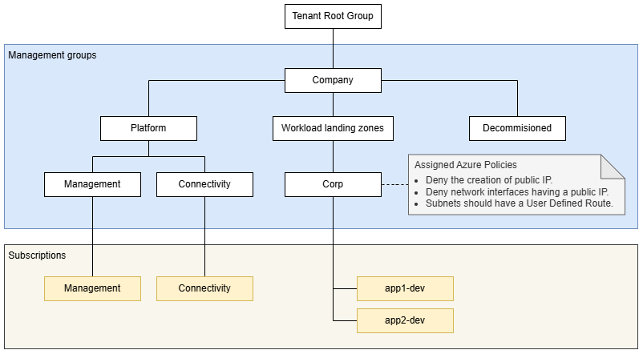
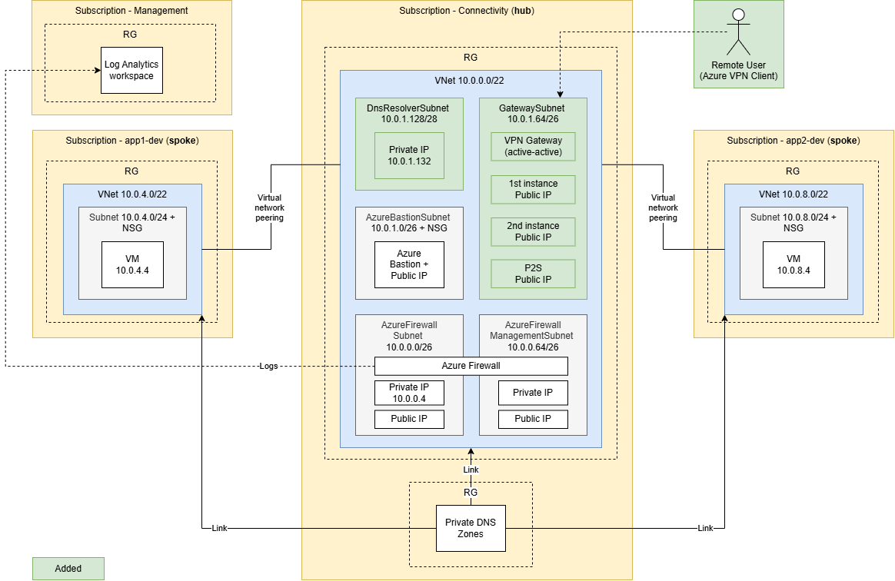

# Minimal hub-spoke topology in Azure via Bicep - part 4

Minimal hub-spoke network in Azure, built with Bicep and Azure Verified Modules (AVM), following the Azure landing zone (ALZ) layout: a management subscription with a central Log Analytics workspace, a hub with Azure Firewall (Basic), Azure Bastion, a point-to-site VPN gateway with Microsoft Entra ID sign-in, a DNS Private Resolver and Private DNS, and two spokes. All traffic leaving a spoke goes through the firewall, and so does VPN client traffic to the spokes; spoke subnets are private. Compared to part 3, this part adds a point-to-site (P2S) VPN gateway with Microsoft Entra ID authentication and a DNS Private Resolver.

Management groups:



Deployed subscriptions:



## Prerequisites

```powershell
winget install --exact --id Microsoft.AzureCLI
az bicep upgrade
Install-Module Az.Network   # only to deallocate the firewall (see Clean up)
```

The subscriptions (management, connectivity, app1-dev, app2-dev) must already exist. Bicep does not create them.

## Configuration

Fill in these values in [config/platform.json](config/platform.json):

```
tenantId
sshPublicKeyPath
testUserUpn
management.subscriptionId
connectivity.subscriptionId
landingZones.app1-dev.subscriptionId
landingZones.app2-dev.subscriptionId
```

Leave the `objectId` values empty; `setup-entra.ps1` fills them in. If you don't have an SSH key yet:

```powershell
ssh-keygen -t ed25519 -f "$HOME\.ssh\azure-hub-spoke-template-04" -C "azure-hub-spoke-template-04"
```

## Deploy

Run from the repo root.

```powershell
az login --tenant '<tenant-id>'

./scripts/setup-entra.ps1               # test user and Entra ID groups; writes their object IDs to the config
./scripts/setup-management-groups.ps1   # management group hierarchy, subscription placement
./scripts/deploy-governance.ps1         # Azure Policy on the Corp management group
./scripts/deploy.ps1                    # management, hub (about 45 minutes with the VPN gateway), app1, app2
```

The hub has to be deployed before the spokes: their peerings use the hub's VPN gateway (gateway transit), so VPN clients get routes to them.

## Test

Sign in to the Azure portal as the test user (with the one-time password you entered while executing `setup-entra.ps1`, you'll be asked to change it), open the app1 VM, then select **Connect** → **Bastion** → **Microsoft Entra ID** → **Connect**, and run:

```bash
ping -c 4 vm-conntest-app2-dev-swedencentral-001.hubspoke.internal   # spoke to spoke: 10.0.8.4
curl -s -m 10 https://api.ipify.org                                  # internet: the public IP of pip-afw-hub-shared-swedencentral-001
```

Both show up in the firewall log after a few minutes:

```powershell
$workspaceId = az monitor log-analytics workspace show -g rg-management-shared -n log-management-shared-swedencentral-001 --subscription '<management-subscription-id>' --query customerId -o tsv
az monitor log-analytics query -w $workspaceId --analytics-query "AZFWNetworkRule | where TimeGenerated > ago(30m) | project TimeGenerated, SourceIp, DestinationIp, Protocol, Action, Rule" -o table
```

### Connect from your computer (P2S VPN)

Install the [Azure VPN Client](https://learn.microsoft.com/azure/vpn-gateway/point-to-site-entra-vpn-client-windows) and download the client profile (it prints a URL to a zip):

```powershell
az network vnet-gateway vpn-client generate -g rg-hub-shared -n vgw-hub-shared-swedencentral-001 --subscription '<hub-subscription-id>' -o tsv
```

In `AzureVPN/azurevpnconfig.xml`, replace `<clientconfig i:nil="true" />` with the block below, so the private zones resolve through the DNS Private Resolver:

```xml
<clientconfig>
  <dnsservers><dnsserver>10.0.1.132</dnsserver></dnsservers>
  <dnssuffixes><dnssuffix>.hubspoke.internal</dnssuffix></dnssuffixes>
</clientconfig>
```

Edit the file before you import it, because the client keeps its own copy. Import the file in Azure VPN Client, connect, and sign in with your Entra ID account. The firewall allows only HTTPS and ping from VPN clients to the spokes; VM admins sign in through Bastion:

```powershell
Resolve-DnsName vm-conntest-app1-dev-swedencentral-001.hubspoke.internal   # 10.0.4.4
Test-Connection 10.0.4.4 -Count 2                                         # allowed
Test-NetConnection 10.0.4.4 -Port 22                                      # denied by the firewall
Test-NetConnection 10.0.4.4 -Port 80                                      # denied by the firewall
```

Download the profile again after you add a spoke. Adding a spoke also means adding its address prefix to `config/platform.json` and redeploying the hub before the spoke, so that VPN traffic to it goes through the firewall.

## Clean up

The firewall (about $290/month), the DNS resolver (about $180/month), the VPN gateway (about $140/month) and Bastion (about $140/month) are the most expensive parts. The gateway, the resolver and Bastion can't be stopped; the commands to delete them are below. Deallocate the firewall when idle (Azure PowerShell; redeploying the hub starts it again):

```powershell
$fw = Get-AzFirewall -ResourceGroupName rg-hub-shared -Name afw-hub-shared-swedencentral-001
$fw.Deallocate()
Set-AzFirewall -AzureFirewall $fw
```

Bastion can't be stopped. Delete it, and set `deployBastion = false` in [platform/connectivity/main.bicepparam](platform/connectivity/main.bicepparam) so the next deployment doesn't recreate it:

```powershell
az network bastion delete -g rg-hub-shared -n bas-hub-shared-swedencentral-001 --subscription '<hub-subscription-id>'
az network public-ip delete -g rg-hub-shared -n pip-bas-hub-shared-swedencentral-001 --subscription '<hub-subscription-id>'
```

The DNS resolver can't be stopped either. VPN clients can't resolve the private zones while it's gone. Set `deployDnsResolver = false` in [platform/connectivity/main.bicepparam](platform/connectivity/main.bicepparam), then delete it. The inbound endpoint goes first:

```powershell
az extension add -n dns-resolver
az dns-resolver inbound-endpoint delete -g rg-hub-shared --dns-resolver-name dnspr-hub-shared-swedencentral-001 -n in-dnspr-hub-shared-swedencentral-001 --yes --subscription '<hub-subscription-id>'
az dns-resolver delete -g rg-hub-shared -n dnspr-hub-shared-swedencentral-001 --yes --subscription '<hub-subscription-id>'
```

The VPN gateway can't be stopped, and the spokes' peerings use it, so they have to let go of it first. Set `vpnGatewayEnabled: false` in [config/platform.bicep](config/platform.bicep), make sure the test VMs are running, and redeploy every landing zone, one at a time:

```powershell
$env:ADMIN_SSH_PUBLIC_KEY = Get-Content "$HOME\.ssh\azure-hub-spoke-template-04.pub"   # the param files read it
az deployment sub create -n spoke-app1-dev -l swedencentral -f landing-zones/main.bicep -p landing-zones/app1-dev.bicepparam --subscription '<app1-subscription-id>'
az deployment sub create -n spoke-app2-dev -l swedencentral -f landing-zones/main.bicep -p landing-zones/app2-dev.bicepparam --subscription '<app2-subscription-id>'
```

Then delete the gateway and its three public IPs:

```powershell
az network vnet-gateway delete -g rg-hub-shared -n vgw-hub-shared-swedencentral-001 --subscription '<hub-subscription-id>'
az network public-ip delete -g rg-hub-shared -n pip-vgw-hub-shared-swedencentral-001-01 --subscription '<hub-subscription-id>'
az network public-ip delete -g rg-hub-shared -n pip-vgw-hub-shared-swedencentral-001-02 --subscription '<hub-subscription-id>'
az network public-ip delete -g rg-hub-shared -n vgw-hub-shared-swedencentral-001-pip3 --subscription '<hub-subscription-id>'
```

Deallocate the test VMs. Start them again (`az vm start`) before you redeploy a landing zone; Azure can't change extensions on a stopped VM.

```powershell
az vm deallocate -g rg-spoke-app1-dev -n vm-conntest-app1-dev-swedencentral-001 --subscription '<app1-subscription-id>'
az vm deallocate -g rg-spoke-app2-dev -n vm-conntest-app2-dev-swedencentral-001 --subscription '<app2-subscription-id>'
```

Or delete all resource groups. Uncomment the last sections of the script to also remove the policy, management groups and Entra ID objects.

```powershell
./scripts/cleanup.ps1
```
